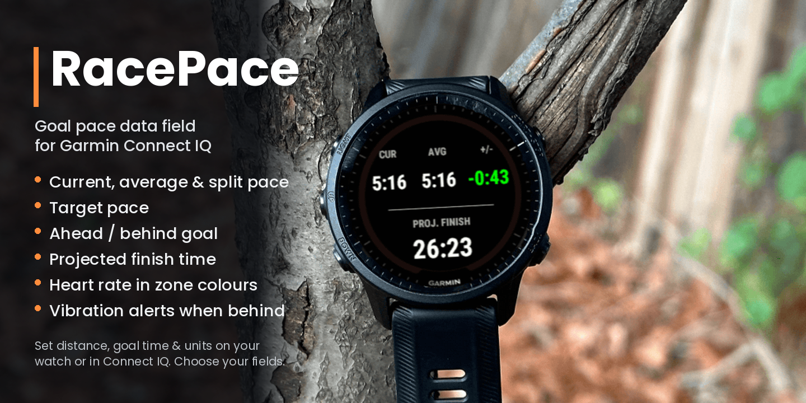
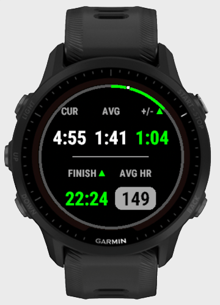
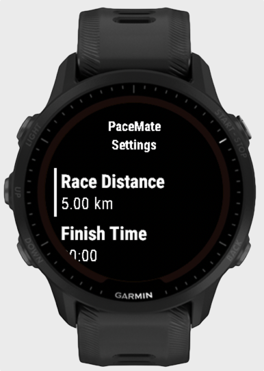

# RacePace

**Free goal pace & projected finish time data field for Garmin watches (Connect IQ)**

[**Get RacePace free on the Garmin Connect IQ Store →**](https://apps.garmin.com/apps/44405c69-eb9b-4489-8685-c635ea78947d)

RacePace is a **free** Garmin Connect IQ data field for runners chasing a goal time in a 5K, 10K, half marathon, marathon, or any custom distance. Enter your race distance and target finish time, and it shows you — live, on one screen — whether you're ahead of or behind goal pace, and what finish time you're on track for.

## What problem does it solve?

On race day, most runners want answers to two questions: *"Am I on pace for my goal time?"* and *"What time am I going to finish in?"* Garmin's stock screens show your pace, but leave you doing mental maths against your goal mid-race. RacePace does that maths for you.

Use it if you:

- are running a marathon or half marathon with a goal time (sub-4, sub-3:30, sub-2 half, a Boston qualifier / BQ pace, etc.)
- want to know your **target pace per km or per mile** without memorising a pace band
- want a live **projected finish time** and how many seconds ahead or behind your goal you are
- want a gentle **vibration alert when you drop off goal pace**
- want all of this in a **single full-screen data field** rather than spread over several screens

## Features

RacePace shows exactly what you need, when you need it:

- **Current Pace** — your real-time pace
- **Average Pace** — your average pace across the whole activity so far
- **Km/Mi Split Pace** — your live pace for the km or mile you're currently in
- **Target Pace** — the pace you need to hit your goal
- **Ahead/Behind** — how far you're ahead of or behind target pace, updated live
- **Finish +/-** — how far ahead or behind your goal finish time you're projected to end up
- **Projected Finish** — your estimated finish time based on current effort

No clutter, no digging through menus mid-race — just the numbers that matter, laid out clearly so you can check your progress with a glance at your wrist. Every field except Current Pace can be turned on or off, and whatever's left grows to fill the space.

Optionally, RacePace can also nudge you on-device when you drift off pace — see **Pace Alerts** below.

## Setup

### 1. Install

RacePace is free. Install it from the [Connect IQ Store](https://apps.garmin.com/apps/44405c69-eb9b-4489-8685-c635ea78947d) on the web, or search for **RacePace** in the Connect IQ Store app, Garmin Connect Mobile, or Garmin Express.

### 2. Add it to a run activity

RacePace is a data field, so it needs to be added to a data screen on a run profile:

1. From the watch face, press **START/ENTER** and select **Run** (or your preferred running activity).
2. Before starting, scroll to a data screen and hold **MENU** to edit it.
3. Select **Edit Layout** and choose the **1-field** layout — RacePace is dense enough to stand alone and already shows pace, delta, and finish time together, so a multi-field layout just wastes space.
4. Pick **RacePace** from the Connect IQ Fields section for that field slot.

### 3. Configure it

Fully configurable, right on your watch. Set your race distance, target finish time, and preferred unit (km or miles) directly on the device — no phone required.

**On the watch:**

1. Press **START** and select **Run**.
2. Select **Settings** (button position varies by model - often the middle-left button).
3. Scroll to **Connect IQ Fields** and select it.
4. Select **RacePace**.
5. Press **MENU** to open RacePace's own settings.

| Setting       | Description                                                    |
| ------------- | ---------------------------------------------------------------- |
| Race Distance | 5K, 10K, Half Marathon, Marathon, or any custom distance          |
| Finish Time   | your goal time — opens Hours / Minutes / Seconds rows, each picked from a scrollable list |
| Units         | kilometers or miles                                             |

**From your phone:** prefer to set it up beforehand? Open Garmin Connect Mobile → **Devices** → your watch → **Data Fields / Connect IQ Store** → RacePace → **Settings**, and enter the same three values. Changes sync to the watch automatically.

**Choosing which fields show:** which fields appear on screen, and how sensitive Current Pace is to GPS noise, is configured from your phone only — Garmin Connect Mobile/Express → **Devices** → your watch → **Data Fields / Connect IQ Store** → RacePace → **Settings**.

| Field | Default | Description |
| ----- | ------- | ----------- |
| Current Pace | always on | Your real-time pace, smoothed over the Pace Smoothing distance below. |
| Average Pace | on | Your average pace across the whole activity so far, from the start of the run to now. |
| Km/Mi Split Pace | off | Your live pace for the km or mile you're currently in — resets and starts timing fresh every time you complete one. |
| Target Pace | off | The pace you need to hold to hit your goal finish time, worked out from Race Distance and Finish Time. |
| Ahead/Behind | on | How far ahead of or behind your target pace you're currently running, updated live. Green means ahead, red means behind. Compares against target pace even if Target Pace itself is hidden. |
| Finish +/- | off | How far ahead of or behind your goal finish time you're projected to end up, based on your pace so far — not the same as Ahead/Behind, which compares your instantaneous pace rather than your likely finish. |
| Projected Finish | on | Your estimated finish time if you keep running at your current pace — a live "if you keep this up" estimate, not a fixed prediction from your goal. |

Turn a field off and the remaining fields grow to fill the space, so the layout stays balanced whatever combination you pick.

**Pace Smoothing:** Current Pace is averaged over a short rolling distance rather than raw instantaneous GPS speed, so it doesn't jump around under trees or between buildings. This is also phone-configured:

| Option | Description |
| ------ | ----------- |
| 50 m | More responsive to pace changes, but shows more raw GPS jitter. |
| 100 m | Default — a balance of responsiveness and smoothness. |
| 200 m | Smoother reading, but slower to catch real pace changes. |

**Pace Alerts:** off by default. When turned on, RacePace nudges you on-device if you fall behind target pace for too long, and again when you get back on pace — so you don't have to keep glancing down. Also phone-configured:

| Setting | Options | Description |
| ------- | ------- | ----------- |
| Pace Alerts | on / **off** | Master switch for alerts. Everything below only applies once this is on. |
| Alert After Behind Pace For | 15s / 30s / 60s | How long you need to be continuously behind target pace before the first alert fires. |

Once the first alert fires, RacePace repeats it every 60 seconds for as long as you're still behind pace, then stops alerting altogether after 5 minutes — so it nudges you a few times rather than nagging indefinitely if you've deliberately backed off (a hill, a walk break). The moment you're back on pace, you get a single "back on pace" alert and the whole cycle resets, ready to trigger again if you fall behind later. Each alert type has its own vibration pattern (where your watch has a vibration motor) so you can tell them apart without looking.

### 4. Run

Start your activity as normal. Current pace needs some GPS-tracked movement (per the Pace Smoothing distance above) to settle into a steady reading — that's by design, so it reflects your real recent pace rather than jumpy instantaneous GPS speed.

See the field table above for what each value on screen means.

Whether you're chasing a PB, pacing a training run, or just want a clearer view of how the race is unfolding, RacePace keeps you focused on what matters: hitting your target.

## How is RacePace different from Garmin's built-in features?

Garmin watches already include some pacing tools. RacePace is built to complement them:

| | RacePace | Virtual Partner | PacePro | Race Predictor |
| --- | --- | --- | --- | --- |
| Set up with just distance + goal time | ✅ | pace only | needs a plan built for a course/distance | no goal input |
| Live ahead/behind your goal pace | ✅ | ✅ | ✅ (per split) | ❌ |
| Live projected finish time vs. your goal | ✅ | ❌ | ❌ | estimate from fitness, not your live run |
| Current, average, split and target pace on one screen | ✅ | ❌ | ❌ | ❌ |
| Set up entirely on the watch, no phone needed | ✅ | ✅ | varies by watch | n/a |

If you just want one screen that answers *"am I on track for my goal time?"* with no course planning, RacePace is the simplest option. You can still use it alongside PacePro or Virtual Partner on other data screens.

## FAQ

**Does it work for marathons and half marathons?**
Yes. Marathon, Half Marathon, 5K and 10K are built-in presets, and you can enter any custom distance (e.g. 15K, 30K, 50K ultra).

**Can I use miles instead of kilometres?**
Yes. Choose kilometers or miles in settings; all paces show as min/km or min/mile.

**Do I need my phone to set it up?**
No. Race distance, goal finish time and units can all be set on the watch. Display options (which fields show, pace smoothing, background colour, pace alerts) are set from Garmin Connect Mobile or Garmin Express.

**Will it vibrate if I fall behind goal pace?**
Yes, if you turn on Pace Alerts (off by default). See [Pace Alerts](#3-configure-it) above.

**Does it work on treadmill or trail runs?**
It works on any running activity. Pace comes from the watch's speed and distance, so accuracy depends on GPS (outdoors) or your footpod/wrist calibration (indoors).

**Is it a watch face or an app?**
Neither. It's a Connect IQ **data field**: you add it to a data screen inside a run activity profile.

**Does it work on my watch?**
See the list below. If your watch isn't listed, [open an issue on GitHub](https://github.com/mrvautin/racepace/issues) to request support.

## Compatible devices

- **Forerunner:** 165 / 165 Music, 170 / 170 Music, 245 / 245 Music, 255 / 255 Music / 255S / 255S Music, 265 / 265S, 570 (42mm / 47mm), 745, 945 / 945 LTE, 955 / 955 Solar, 965, 970
- **fēnix (Fenix):** 6 / 6S / 6 Pro / 6S Pro / 6X Pro (incl. Solar, Sapphire and Dual Power), 7 / 7S / 7X, 7 Pro / 7S Pro / 7X Pro (incl. Solar no-Wi-Fi), 8 (43mm / 47mm / 51mm), 8 Solar (47mm / 51mm), 8 Pro, E
- **epix:** epix (Gen 2), epix Pro (Gen 2) 42mm / 47mm / 51mm
- **Enduro:** Enduro, Enduro 2, Enduro 3
- **Venu:** 2 / 2S / 2 Plus, 3 / 3S, 4 (41mm / 45mm)
- **vívoactive (Vivoactive):** 4 / 4S, 5, 6
- **Instinct:** Instinct 3 AMOLED (45mm / 50mm)
- **Also:** MARQ (Gen 2), quatix 6 / 7 / 8, tactix 7 / 8 / Delta, D2 Mach 1 Pro / Air X15

## Development

Connect IQ data field written in Monkey C. See [manifest.xml](manifest.xml) for the app manifest and [monkey.jungle](monkey.jungle) for the build configuration.

## License

RacePace is free and open source under the [MIT License](LICENSE).
